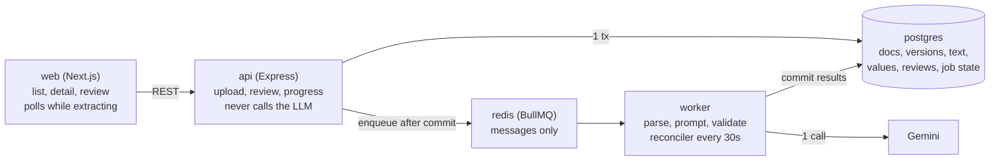

# HLD

Doc extraction + review app. Upload a PDF, the LLM pulls out fields, a person checks each value against the exact quote
it came from. When a new version of a doc comes in, reviews carry over for anything whose evidence didn't change.

Implementation details are in [LLD.md](./LLD.md).

## Stack

- API: Express 5 + TypeScript, zod for validation
- Worker: separate node process, BullMQ consumer
- UI: Next.js 16 (app router, client components) + TanStack Query + CSS Modules
- DB: Postgres 17 + Prisma 7 (pinned, see below)
- Queue: BullMQ on Redis 8
- LLM: Gemini (flash), structured JSON output, temperature 0. Model name comes from `GEMINI_MODEL`
- PDF parsing: unpdf
- Monorepo: Turborepo + pnpm workspaces
- Logging: pino. Tests: Vitest (+ Playwright for the UI)
- PDFs are stored as bytea in postgres. They're one page each, so no object storage for now

Everything runs with `docker compose up`. If I deploy: api + worker + redis on Railway, web on Vercel, db on Supabase.

### Notes on the stack

**Prisma 7, not 8.** `npm i prisma` currently installs Prisma 8, which is still a release candidate and changes the
query API. Pinning 7. Things to remember with 7: it needs `prisma.config.ts`, it needs the pg driver adapter (
`@prisma/adapter-pg`), and it doesn't load .env on its own.

**Redis.** Locally it's the official `redis:8-alpine` image with `--maxmemory-policy noeviction` (BullMQ needs that).
For hosting I'd put Redis on Railway next to the worker. Skipping the Upstash free tier, BullMQ workers poll a lot and
would burn through 500k commands/month fast. Redis Cloud free (30MB) is the fallback.

**Supabase.** Not needed to build or run anything, it's just Postgres. Local dev and compose use a postgres container,
and migrations + seed run automatically in compose. If it goes on Supabase: session pooler (port 5432) for api and
worker since they're long running processes, and free projects pause after a week with no activity.

**Gemini.** `@google/genai` with `responseMimeType: "application/json"` and a schema. Gemini treats schema fields as
optional unless they're marked required, so every field is required and "not found" is null.

## Architecture



Main rule: postgres owns all the state that matters (docs, versions, parsed text, values, reviews, job status, errors).
Redis only carries "extract version X" messages. If redis loses everything, a reconciler in the worker re-adds whatever
postgres says isn't done yet.

## Repo layout

```
repo/
  CLAUDE.md               repo-wide agent rules, imports the two below
  README.md
  fixtures/               as provided, read by the seed
  apps/
    api/                  express: routes, validation, error mapping. Thin. (CLAUDE.md: backend rules)
    worker/               bullmq processor + reconciler. Thin
    web/                  next.js UI (CLAUDE.md: frontend rules)
  packages/
    contracts/            zod schemas + types for every request/response, error codes, field defs
    core/                 business modules (documents, extraction, reviews): service, repository, ports,
                          plus the pure bits (prompt, validate, normalise, diff)
    adapters/             gemini, unpdf, bullmq implementations of core's ports + test fakes
    db/                   prisma schema, migrations, client, seed
    tsconfig/ eslint-config/
  turbo.json
  docker-compose.yml
  Dockerfile              multi-stage, one target per app, built with turbo prune
```

Business rules live once in `core`, and both the API and the worker call the same services. The apps are just the
HTTP and queue edges. Anything external (LLM, PDF parsing, queue) is a port in core with the real thing in
`adapters`, so tests swap in fakes and nothing needs docker or a Gemini key to unit test. The pure files in
`core/modules/extraction` (validate, normalise, diff, prompt) are where most of the tests go.

Who imports what: web only gets `contracts`. api and worker get `core`, `adapters`, `contracts` and `db` (just to
build the client). core never imports express, bullmq, the gemini SDK or unpdf. pnpm's strict linking enforces most
of this already.

turbo.json: `build` depends on `^build`, `test` / `lint` / `typecheck` run per package, `db:generate` runs before
build.

## Code conventions

The full rules are in the three CLAUDE.md files. Short version:

- files and folders kebab-case, variables camelCase, types and components PascalCase, constants UPPER_SNAKE
- DB tables and columns snake_case (Prisma `@map`), API JSON camelCase, error codes snake_case
- 4-space indent, prettier at 120 columns
- every table has created/updated/deleted at + by. No users yet, so every `*_by` is the all-zeros system id
- errors are always `{"error": "<code>", "detail": "..."}`
- backend: routers only do HTTP, services own the transaction, repositories own the queries
- frontend: `app/` only re-exports, each screen is a module folder (index.tsx for UI, hooks.ts for logic,
  constants.ts, styles.module.css), all fetching goes through `services/`, which can run fully mocked

## docker compose

- postgres: `postgres:17-alpine`, user/password `postgres`/`postgres`, database `lomi-pdf-extractor`, named volume,
  `pg_isready` healthcheck. Host port 5433 by default (`POSTGRES_PORT`) so it doesn't fight a native postgres on 5432
- redis: `redis:8-alpine` with noeviction and appendonly
- migrate: `prisma migrate deploy`, then the seed (v1 of each fixture), then exits. Seed is idempotent
- api (4000), worker, web (3000): start after migrate finishes
- one root `Dockerfile`, a target per app, `turbo prune <app> --docker` first. Internal packages ship TS source: the
  api is bundled with tsdown (workspace packages inlined), web uses Next `transpilePackages` + `output: standalone`.
  `API_URL` is a build arg for web because Next bakes rewrites in at build time

Only `GEMINI_API_KEY` has to be set. Everything else has a default in `.env.example`.

## Flows

**Upload.** One transaction writes the doc + version (pdf bytes, sha256, status queued). After commit, enqueue with
jobId = versionId and return 202. If the enqueue fails it still returns 202, the row is queued and the reconciler will
pick it up.

**Extract (worker).** Claim the version (queued -> extracting, attempts + 1, set a lease). Parse and store the text
once. Call Gemini, save the prompt and raw response. Validate every field. Then write values + carry-over + status in
one transaction behind a fencing check.

**Review.** Append a review row: approve, or correct with a value and an optional note. Latest review wins.

**Reads.** Straight from postgres.

## Failure cases

| what happens                        | state left                        | how it recovers                                                                                  |
|-------------------------------------|-----------------------------------|--------------------------------------------------------------------------------------------------|
| enqueue fails after commit          | version queued, nothing in redis  | reconciler re-adds queued versions (same jobId, no dupes)                                        |
| worker killed mid LLM call          | version extracting, lease running | lease expires, reconciler puts it back to queued. After MAX_ATTEMPTS it goes to failed           |
| docker compose restart              | same as above                     | reconciler runs on worker boot                                                                   |
| FLUSHALL + restart                  | redis empty, postgres fine        | same reconciler, nothing important was in redis                                                  |
| same version run twice              | two workers or a retry race       | conditional claim, fencing check on commit, unique(version_id, field). Second run writes nothing |
| gemini error / timeout / bad JSON   | exception in worker               | caught, version -> failed with the error, retry button in the UI                                 |
| PDF has no text                     | exception in parse                | failed with "no extractable text (scanned PDF?)"                                                 |
| postgres down                       | worker can't claim                | bullmq retries with backoff, nothing half written                                                |
| new version uploaded mid extraction | old version superseded            | old worker's commit fails the fencing check, result dropped                                      |

Known limitation: after a hard kill the doc shows `extracting` until the lease runs out (`LEASE_SECONDS`). That's still
visible and it does get retried, so it's never stuck for good. With a single worker, boot can requeue all extracting
rows right away.

## Decisions

### Where the redis / postgres line is

BullMQ can track job state and results itself, but all of that is gone after a FLUSHALL. So job state lives in postgres
and redis only has messages. The reconciler rebuilds the queue from postgres. A postgres-only queue (SKIP LOCKED) would
also work, but the brief asks for redis. An outbox table is what I'd move to at bigger scale.

### Idempotency

BullMQ jobId dedupe only works while the job still exists in redis, so it can't be the guarantee. The real guarantee is
the conditional claim, the fencing check at commit (attempt matches, status still extracting) and unique(version_id,
field). Never delete-and-reinsert values on a rerun, that would wipe reviews.

### Corrections

Corrections are stored next to the value, not over it. The LLM value stays as is, the review row has the corrected value
and a note. Effective value = latest correction, else the LLM value. This keeps what the model said separate from what a
person said, and makes carry-over simple.

### What "unchanged" means

Invoice v2 adds "(REVISED)" to the title and a whole new paragraph, so offsets shift. Comparing positions doesn't work,
and diffing the whole document flags everything. Going with: same value AND (same quote text after whitespace
normalisation OR the old quote still appears somewhere in the new text). No fuzzy matching, it would happily
call $5,230.28 the same as $5,230.29.

### New version while the old one is extracting

Supersede. The upload is accepted right away, the older in-flight version is marked superseded and only the newest one
gets extracted. If the old run finishes late, the fencing check drops its result. Queueing would extract something
nobody reviews, and rejecting would make uploads not instant.

### Parsed text

Stored per version, never re-parsed. Version N's evidence has to keep working after N+1 exists, and a parser update
could change whitespace.

### Polling

The UI polls every 2s only while something is queued or extracting, and stops after. Jobs take seconds and there's one
reviewer, so SSE / websockets aren't worth the extra moving parts here. Would revisit at scale.

### Packages

contracts / core / adapters / db, with the apps on top. One big backend package would hide that the tricky logic is
pure and testable, and putting the business rules inside `apps/api` would mean the worker either duplicates them or
imports from another app. Splitting core from adapters is the hexagonal bit, only at the edges where it pays off.
