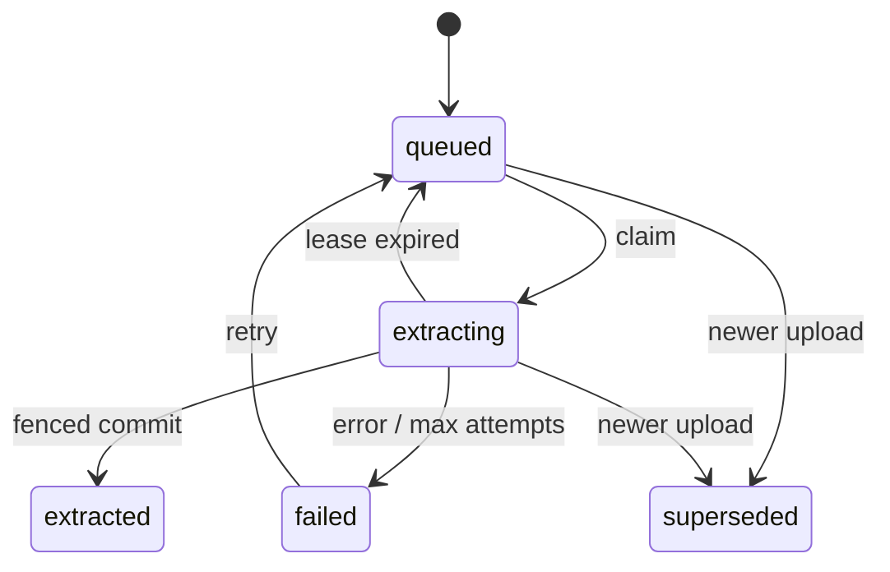

# LLD

Details behind [HLD.md](./HLD.md).

## Schema (Prisma 7)

Versions are immutable. Values belong to one version. Reviews are append-only. Carry-over copies a review onto the new version's value and leaves the old one alone. Nothing gets deleted.

```prisma
generator client {
  provider = "prisma-client"
  output   = "../src/generated"
}
datasource db { provider = "postgresql" }   // url is in prisma.config.ts

// No users table yet. Every *_by column defaults to the system user
// 00000000-0000-0000-0000-000000000000 (SYSTEM_USER_ID in @app/contracts). No FKs on *_by for now.

enum DocType {
  invoice
  lease
  market_report
  @@map("doc_type")
}
enum VersionStatus {
  queued
  extracting
  extracted
  failed
  superseded
  @@map("version_status")
}
enum FieldType {
  string
  date
  money
  number
  percent
  @@map("field_type")
}
enum ChangeStatus {
  new
  unchanged
  changed
  @@map("change_status")
}
enum ReviewAction {
  approve
  correct
  @@map("review_action")
}
enum AttemptOutcome {
  succeeded
  failed
  discarded_superseded
  discarded_stale
  @@map("attempt_outcome")
}

model Document {
  id               String    @id                                   // manifest id for seeds, uuid otherwise
  type             DocType
  title            String?
  currentVersionId String?   @unique @map("current_version_id") @db.Uuid
  versions         DocumentVersion[]

  createdAt        DateTime  @default(now()) @map("created_at") @db.Timestamptz
  createdBy        String    @default("00000000-0000-0000-0000-000000000000") @map("created_by") @db.Uuid
  updatedAt        DateTime  @default(now()) @updatedAt @map("updated_at") @db.Timestamptz
  updatedBy        String    @default("00000000-0000-0000-0000-000000000000") @map("updated_by") @db.Uuid
  deletedAt        DateTime? @map("deleted_at") @db.Timestamptz
  deletedBy        String?   @map("deleted_by") @db.Uuid

  @@map("document")
}

model DocumentVersion {
  id          String        @id @default(uuid()) @db.Uuid
  documentId  String        @map("document_id")
  version     Int
  fileName    String        @map("file_name")
  pdf         Bytes
  sha256      String
  parsedText  String?       @map("parsed_text")                  // set once, all evidence checks use this
  status      VersionStatus @default(queued)
  attempts    Int           @default(0)
  leaseUntil  DateTime?     @map("lease_until") @db.Timestamptz
  error       String?
  extractedAt DateTime?     @map("extracted_at") @db.Timestamptz
  document    Document      @relation(fields: [documentId], references: [id])
  values      ExtractedValue[]
  runs        ExtractionAttempt[]

  createdAt   DateTime      @default(now()) @map("created_at") @db.Timestamptz
  createdBy   String        @default("00000000-0000-0000-0000-000000000000") @map("created_by") @db.Uuid
  updatedAt   DateTime      @default(now()) @updatedAt @map("updated_at") @db.Timestamptz
  updatedBy   String        @default("00000000-0000-0000-0000-000000000000") @map("updated_by") @db.Uuid
  deletedAt   DateTime?     @map("deleted_at") @db.Timestamptz
  deletedBy   String?       @map("deleted_by") @db.Uuid

  @@index([status, leaseUntil])                                   // reconciler
  @@map("document_version")
  // unique (document_id, version) WHERE deleted_at IS NULL -> partial index in a raw SQL migration
}

model ExtractionAttempt {                                         // prompt + raw response per run
  id           String          @id @default(uuid()) @db.Uuid
  versionId    String          @map("version_id") @db.Uuid
  attempt      Int
  model        String
  prompt       Json
  rawResponse  Json?           @map("raw_response")
  inputTokens  Int?            @map("input_tokens")
  outputTokens Int?            @map("output_tokens")
  outcome      AttemptOutcome?
  error        String?
  startedAt    DateTime        @default(now()) @map("started_at") @db.Timestamptz
  finishedAt   DateTime?       @map("finished_at") @db.Timestamptz
  version      DocumentVersion @relation(fields: [versionId], references: [id])

  createdAt    DateTime        @default(now()) @map("created_at") @db.Timestamptz
  createdBy    String          @default("00000000-0000-0000-0000-000000000000") @map("created_by") @db.Uuid
  updatedAt    DateTime        @default(now()) @updatedAt @map("updated_at") @db.Timestamptz
  updatedBy    String          @default("00000000-0000-0000-0000-000000000000") @map("updated_by") @db.Uuid
  deletedAt    DateTime?       @map("deleted_at") @db.Timestamptz
  deletedBy    String?         @map("deleted_by") @db.Uuid

  @@unique([versionId, attempt])
  @@map("extraction_attempt")
}

model ExtractedValue {
  id              String          @id @default(uuid()) @db.Uuid
  versionId       String          @map("version_id") @db.Uuid
  field           String
  fieldType       FieldType       @map("field_type")
  value           Json?                                         // null = gap
  evidence        String?                                       // quote as the model returned it
  evidenceStart   Int?            @map("evidence_start")        // offsets into this version's parsed_text
  evidenceEnd     Int?            @map("evidence_end")
  gapCode         String?         @map("gap_code")
  gapReason       String?         @map("gap_reason")
  changeStatus    ChangeStatus    @map("change_status")
  previousValueId String?         @map("previous_value_id") @db.Uuid
  version         DocumentVersion @relation(fields: [versionId], references: [id])
  previous        ExtractedValue? @relation("Prev", fields: [previousValueId], references: [id])
  next            ExtractedValue[] @relation("Prev")
  reviews         Review[]

  createdAt       DateTime        @default(now()) @map("created_at") @db.Timestamptz
  createdBy       String          @default("00000000-0000-0000-0000-000000000000") @map("created_by") @db.Uuid
  updatedAt       DateTime        @default(now()) @updatedAt @map("updated_at") @db.Timestamptz
  updatedBy       String          @default("00000000-0000-0000-0000-000000000000") @map("updated_by") @db.Uuid
  deletedAt       DateTime?       @map("deleted_at") @db.Timestamptz
  deletedBy       String?         @map("deleted_by") @db.Uuid

  @@map("extracted_value")
  // unique (version_id, field) WHERE deleted_at IS NULL -> partial index, stops duplicate values
}

model Review {
  id                  String         @id @default(uuid()) @db.Uuid
  valueId             String         @map("value_id") @db.Uuid
  action              ReviewAction
  correctedValue      Json?          @map("corrected_value")
  note                String?
  carriedFromReviewId String?        @map("carried_from_review_id") @db.Uuid
  value               ExtractedValue @relation(fields: [valueId], references: [id])

  createdAt           DateTime       @default(now()) @map("created_at") @db.Timestamptz
  createdBy           String         @default("00000000-0000-0000-0000-000000000000") @map("created_by") @db.Uuid
  updatedAt           DateTime       @default(now()) @updatedAt @map("updated_at") @db.Timestamptz
  updatedBy           String         @default("00000000-0000-0000-0000-000000000000") @map("updated_by") @db.Uuid
  deletedAt           DateTime?      @map("deleted_at") @db.Timestamptz
  deletedBy           String?        @map("deleted_by") @db.Uuid

  @@index([valueId, createdAt])
  @@map("review")
}
```

Raw SQL migration that goes with it (Prisma can't express these):

```sql
-- uniques only count live rows, so a soft-deleted row never blocks a re-insert
CREATE UNIQUE INDEX document_version_doc_version_live
  ON document_version (document_id, version) WHERE deleted_at IS NULL;
CREATE UNIQUE INDEX extracted_value_version_field_live
  ON extracted_value (version_id, field) WHERE deleted_at IS NULL;

-- updated_at for raw SQL updates too (Prisma's @updatedAt only runs through the client)
CREATE FUNCTION set_updated_at() RETURNS trigger AS $$
BEGIN NEW.updated_at = now(); RETURN NEW; END $$ LANGUAGE plpgsql;

CREATE TRIGGER set_updated_at BEFORE UPDATE ON document           FOR EACH ROW EXECUTE FUNCTION set_updated_at();
CREATE TRIGGER set_updated_at BEFORE UPDATE ON document_version   FOR EACH ROW EXECUTE FUNCTION set_updated_at();
CREATE TRIGGER set_updated_at BEFORE UPDATE ON extraction_attempt FOR EACH ROW EXECUTE FUNCTION set_updated_at();
CREATE TRIGGER set_updated_at BEFORE UPDATE ON extracted_value    FOR EACH ROW EXECUTE FUNCTION set_updated_at();
CREATE TRIGGER set_updated_at BEFORE UPDATE ON review             FOR EACH ROW EXECUTE FUNCTION set_updated_at();
```

Conventions:

- DB is snake_case (tables, columns, enum types) through `@map` / `@@map`. Everything in TypeScript is camelCase: Prisma models, zod schemas, API JSON. Raw SQL uses the snake_case names.
- Every table has created_at, created_by, updated_at, updated_by, deleted_at, deleted_by. No users table yet, so every *_by is the system id `00000000-0000-0000-0000-000000000000` and there's no foreign key on them. Once auth exists, the API passes the real user id and the FKs get added.
- Raw updates (claim, commit, reconciler) also set `updated_by = $SYSTEM_USER_ID`. updated_at is handled by the trigger.
- Soft delete only. Nothing deletes rows today, but every read filters `deleted_at IS NULL`. A small Prisma client extension adds that filter by default so it can't be forgotten.
- review and extraction_attempt are append-only, so their updated_* just stays equal to created_* (kept anyway so every table looks the same).


Review state of a value comes from its latest review:

- no review: pending (gaps too)
- has carriedFromReviewId: carried over
- approve: approved
- correct: corrected

The progress buckets don't overlap. Gaps also get their own count.

Value json by type:

- string: `"INV-2025-0847"`
- date: `"2025-09-14"`
- money: `{"amount":"5230.29","currency":"USD"}` (string, not a float)
- percent: `"4.2"`
- number: `24`

No separate job table. A version has exactly one extraction lifecycle, so the status sits on the version. Every try gets an ExtractionAttempt row with the prompt, raw response, tokens and outcome.

## API

Express 5, zod on every input (schemas from `@app/contracts`, shared with the UI). Errors look like
`{"error": "<snake_case_code>", "detail": "<human text>"}` and come from `AppError(code, status, detail)` through one
error handler.

| endpoint | request | response | errors |
| --- | --- | --- | --- |
| `POST /documents` | multipart: type, file (pdf, max 10MB), title? | `202 {id, version: 1, status: "queued"}` | 422 validation_failed, 413 file_too_large, 415 not_a_pdf (checks `%PDF-` bytes) |
| `POST /documents/:id/versions` | multipart: file | `202 {id, version, status: "queued", supersededVersions}` | 404 document_not_found, 415, 413 |
| `GET /documents/:id` | `?version=N`, defaults to current | doc view, see below | 404 |
| `POST /values/:id/review` | `{action: "approve"}` or `{action: "correct", value, note?}` | `201 {review, reviewState}` | 404 value_not_found, 422 invalid_correction, 409 version_not_current |
| `GET /documents/:id/progress` | | `{version, pending, approved, corrected, carriedOver, gaps, total}` | 404 |
| `GET /documents` | | `[{id, type, title, currentVersion, status, progress}]` | |
| `POST /documents/:id/retry` | | `202 {status: "queued"}` | 409 not_retryable |
| `GET /documents/:id/versions` | | `[{version, status, createdAt, extractedAt, error}]` | 404 |

Doc view:

```json
{
  "id": "doc-invoice-001", "type": "invoice", "title": "Invoice — Meridian Office Supplies",
  "version": 2, "currentVersion": 2, "status": "extracted", "error": null,
  "parsedText": "MERIDIAN OFFICE SUPPLIES LLC\n...",
  "values": [{
    "id": "...", "field": "total_amount", "type": "money",
    "value": {"amount": "6126.45", "currency": "USD"},
    "effectiveValue": {"amount": "6126.45", "currency": "USD"},
    "evidence": "Total Due: $6,126.45", "evidenceSpan": [701, 721],
    "gap": null,
    "changeStatus": "changed", "reviewState": "pending",
    "latestReview": null,
    "previous": {"version": 1, "value": {"amount": "5230.29", "currency": "USD"},
                 "evidence": "Total Due: $5,230.29",
                 "review": {"action": "approve", "correctedValue": null, "note": null}}
  }]
}
```

Error codes (they live in `contracts/errors.ts` and the UI maps each one to friendly text):

- `validation_failed` 422, `invalid_correction` 422
- `file_too_large` 413, `not_a_pdf` 415
- `document_not_found` 404, `value_not_found` 404
- `version_not_current` 409, `not_retryable` 409
- `internal_error` 500, generic detail, the real error only goes to the log

A gap looks like `"value": null, "gap": {"code": "NOT_IN_DOCUMENT", "reason": "..."}`.

Notes:

- Upload handlers never parse the PDF or call the LLM. Check the magic bytes and size, hash it, one transaction, done.
- Gaps can be reviewed. correct = a person fills in the value, approve = confirmed it's not in the doc.
- Corrections go through the same normaliser as LLM output, so "$1,985" becomes `{amount: "1985.00", currency: "USD"}`.
- Next rewrites `/api/*` to the API, so there's no CORS setup.

## Version lifecycle

Status lives on document_version.



Three queries do most of the work. Run them with `$executeRaw` / `$queryRaw` inside `prisma.$transaction`.

Claim, before doing anything:

```sql
UPDATE document_version
SET status = 'extracting', attempts = attempts + 1, updated_by = $SYSTEM_USER_ID,
    lease_until = now() + make_interval(secs => $LEASE), error = NULL
WHERE id = $versionId AND status = 'queued'
RETURNING attempts;   -- 0 rows: someone else has it or it got superseded, ack and exit
```

The returned `attempts` is this run's fencing token. Insert the ExtractionAttempt row right after. While waiting on Gemini, extend the lease every LEASE/3 seconds (`... WHERE id = $v AND attempts = $token`).

Commit, one transaction:

```sql
SELECT id FROM document WHERE id = $docId FOR UPDATE;   -- lines up with uploads and reviews
UPDATE document_version SET status = 'extracted', extracted_at = now(), lease_until = NULL
 WHERE id = $versionId AND status = 'extracting' AND attempts = $token;
-- 0 rows: superseded or stale, roll back and mark the attempt discarded
INSERT INTO extracted_value (...) VALUES (...) ON CONFLICT (version_id, field) DO NOTHING;
-- carry-over reviews, then
UPDATE document SET current_version_id = $versionId WHERE id = $docId;
```

Reconciler, on worker boot and every 30s:

```sql
UPDATE document_version
SET status = CASE WHEN attempts >= $MAX THEN 'failed' ELSE 'queued' END,
    error  = CASE WHEN attempts >= $MAX THEN 'gave up after ' || attempts || ' attempts' END
WHERE status = 'extracting' AND lease_until < now();

SELECT id FROM document_version WHERE status = 'queued';
-- queue.add('extract', {versionId: id}, {jobId: id}) for each
```

Adding a job with an existing jobId does nothing, so the sweep can run as often as needed. BullMQ is set to `removeOnComplete: true` and `attempts: 1`, retry counting is postgres' job.

If something throws inside the job: catch it, set the version to failed with the error (`WHERE id = $v AND attempts = $token`), close the attempt row. Don't rethrow to BullMQ. Retries come from the retry button, or the lease path for crashes.

## Extraction

One Gemini call per version. After that it's plain code deciding what to trust: nothing gets stored as a value until its quote is found in the text and the value matches the quote.

```ts
export async function extract(input: {
  type: DocType; fields: FieldDef[]; parsedText: string; llm: LlmClient;
}): Promise<{ values: ValidatedValue[]; prompt: object; raw: unknown; usage?: Usage }>
```

### Parse

`extractText(bytes, {mergePages: true})` from unpdf. Store the result as is in parsed_text (no trimming, so offsets stay correct). Empty or tiny text (under ~20 chars) throws, and the version goes to failed.

### Gemini call

`GEMINI_MODEL`, temperature 0, `responseMimeType: "application/json"`, and this schema with every field required:

```ts
const Item = z.object({
  field:      z.enum(fieldNamesForType),
  found:      z.boolean(),
  value:      z.string().nullable(),   // always a string, converted per type on our side
  currency:   z.string().nullable(),   // money only
  evidence:   z.string().nullable(),   // verbatim quote
  gap_reason: z.string().nullable(),
});
const Output = z.object({ fields: z.array(Item) });
```

`value` is always a string because Gemini follows the schema more reliably with one type per property. The server converts it based on the field's type.

System prompt, roughly:

```
You extract fields from a document for human review.
1. Return exactly one entry per requested field.
2. Only use values explicitly stated in the document. Don't compute, infer, convert or guess.
3. evidence = the shortest passage copied exactly from the document that states the value,
   including its label ("Total Due: $5,230.29", not "$5,230.29"). Don't fix typos or spacing.
4. If the field isn't stated: found=false, value=null, evidence=null, gap_reason=why.
5. Formats: date YYYY-MM-DD, money as a plain number "5230.29" + currency, percent "4.2", number "24".
6. Pick the value the field asks for, not a nearby one (subtotal isn't total, last quarter isn't this quarter).
```

User message = field list with a one line description each, then the text inside `<document>...</document>`. Save the request and raw response on the attempt before validating.

Field descriptions live in code. A few that matter: vendor_name is the company issuing the invoice, not the Bill To party. average_rent_1br is one-bedroom only. term_months is the lease length in months.

### Validation

Per requested field, in this order:

| # | check | if it fails |
| --- | --- | --- |
| 1 | response matches `Output` | whole run fails (LLM_BAD_OUTPUT), retryable |
| 2 | there's an entry for the field (first one wins) | MISSING_FROM_RESPONSE |
| 3 | found is true and value isn't null | NOT_IN_DOCUMENT, keep the model's reason |
| 4 | evidence isn't empty | NO_EVIDENCE |
| 5 | `norm(evidence)` is in `norm(parsedText)` | EVIDENCE_NOT_FOUND |
| 6 | value parses as the field type | UNPARSEABLE_VALUE |
| 7 | value is backed by the evidence | VALUE_NOT_IN_EVIDENCE |

`norm(s) = s.normalize("NFKC").replace(/\s+/g, " ").trim()`. Keep a map from normalised positions back to original ones so evidenceStart/End point into the real text for highlighting. If a short quote matches more than once, keep the first match and log it.

Check 7 by type:

- money / number / percent: the value's digits (separators stripped) have to show up in the evidence (separators stripped)
- date: the evidence has the ISO date, or a written date that parses to the same day ("March 1, 2025")
- string: the value (case and whitespace ignored) is inside the evidence

### Normalisers

Shared with review corrections.

- money: `5230.29`, `$5,230.29`, `5,230.29 USD` -> `{amount: "5230.29", currency: "USD"}`. Currency only defaults to USD if there's a `$` in the evidence
- percent: `4.2`, `4.2%` -> `"4.2"`
- date: ISO, `March 1, 2025`, `1 Mar 2025` -> `"2025-03-01"`
- number: `24`, `twenty-four (24)` -> `24`
- string: trimmed

## Gaps

A gap is a field we asked for but can't back up with a quote from this version's text. It's stored as value null + a code + a reason, and shown to the reviewer.

The brief is strict about this: a value whose quote isn't verbatim in the text becomes a gap (never kept, never silently dropped), and a field that isn't found is a gap with a reason, never a guess. The point is that a plausible but unproven number is worse than a blank, because someone skimming a lot of values will approve it.

A gap isn't a failure. A failure is the whole run breaking (Gemini down, bad JSON, unreadable PDF), the version goes to failed and gets retried. A gap is one field inside a run that worked.

**NOT_IN_DOCUMENT.** The model says the field isn't there. median_household_income in the market report is the planted one, the report has rents and vacancy but no income. Store the model's reason. The reviewer can approve it (confirmed not in the doc) or correct it with a value they know. No second "try harder" call, that just pushes the model into making something up.

**EVIDENCE_NOT_FOUND.** There's a quote but it isn't in the text, even after normalising. Could be a paraphrase, fixed casing, two lines merged, or a passage that was made up entirely. There's no way to tell those apart, which is exactly why it's a gap. The model's suggestion stays in the attempt log only. Later option: re-ask once for just those fields. Not doing fuzzy or case-insensitive matching, that breaks the verbatim rule.

**VALUE_NOT_IN_EVIDENCE.** The quote is real but the value isn't in it. E.g. vacancy 4.9 (last quarter) with the quote "vacancy rate declined to 4.2%", or total 4815.00 (the subtotal) with the "Total Due: $5,230.29" line. The brief only asks for the quote check, this one is extra. Could auto-pull the number from the evidence when there's only one, but then the code is doing the extraction, so no.

**NO_EVIDENCE.** A value with no quote. Nothing to check it against.

**UNPARSEABLE_VALUE.** Can't convert it to the field's type, like a date field coming back as "Q3 2025".

**MISSING_FROM_RESPONSE.** The model skipped the field. The row still gets created so every expected field shows up for the reviewer.

Things that would cause fake gaps if not handled:

- line breaks inside a quote. The lease has "twenty-four (24)" and "months" on separate lines, so normalise whitespace on both sides
- different parsers space things differently (`Total Due:      $5,230.29` vs `Total Due: $5,230.29`), so the model gets the exact stored text we validate against
- the same text twice. "2025-09-14" appears twice in invoice v2, so ask for labelled quotes and keep the first match
- written dates ("March 1, 2025"), which the date check accepts

After extraction: gaps sit at the top of the detail page with their reason, and stay pending until reviewed. A gap in both versions counts as unchanged and its review carries over. Gap -> value or value -> gap counts as changed.

## Carry-over

A field is unchanged when the value is the same and its proof still holds in the new text, judged by the quote text, never by position. Unchanged fields get their latest review copied forward. Changed ones go back to pending with the old value and review attached.

The baseline is the latest version before this one that actually got extracted. Superseded and failed versions are skipped, so if v2 was superseded, v3 is compared to v1. A first version has no baseline and everything is new.

```ts
function classify(P: Prev | undefined, N: Next, newText: string): ChangeStatus {
  if (!P) return 'new';
  if (P.value === null && N.value === null) return 'unchanged';   // still a gap
  if (P.value === null || N.value === null) return 'changed';     // appeared or disappeared
  if (!sameValue(P.value, N.value, P.fieldType)) return 'changed';
  const sameQuote = norm(P.evidence) === norm(N.evidence);
  const oldStillThere = norm(newText).includes(norm(P.evidence));
  return sameQuote || oldStillThere ? 'unchanged' : 'changed';
}
```

Then, in the commit transaction:

- unchanged and P had a review: insert a review on N copying action, correctedValue and note, with carriedFromReviewId = P's review. Shows as carried over
- unchanged but P was never reviewed: N is just pending. changeStatus still says unchanged so the UI can show "same as v1"
- changed: N is pending, previousValueId = P, and the UI shows P's value and review next to it
- new: pending

P's latest reviews are read inside the transaction after locking the document row. So a review that lands a second before the commit still gets carried, and one that comes after gets a 409 (old versions are read-only).

Why it's done this way:

- quote text instead of offsets, because v2 adds "(REVISED)" and a 2-line paragraph and every offset after that moves
- the "old quote still there" check, because Gemini might quote a different passage for the same fact on v2 (like the new "supersedes the version issued on 2025-09-14" sentence). Without it issue_date would go back to review for no reason
- value has to match too, because an old quote can stay in the doc while the actual value moved somewhere else
- typed comparison, so "5230.29" and "5,230.29" are equal but 2025-10-14 and 2025-11-13 aren't
- corrections carry over, not just approvals, so a fix made on v1 doesn't get asked again or reverted on v2

Known gap: the "old quote still there but means something else now" case is unlikely with labelled quotes, but not impossible. At scale I'd anchor on the label line per field.

Supersede:

- `POST /documents/:id/versions` locks the document row, marks queued/extracting versions as superseded, inserts the new version as queued, commits, then enqueues
- current_version_id only moves once a version finishes extracting. Until then the UI keeps showing the last extracted version (still reviewable) with a "v3 extracting..." banner
- the superseded run keeps going until its fenced commit returns 0 rows, then logs discarded_superseded. Could check the status before calling Gemini to skip the call
- superseded versions stay in history with no values

## Expected results on the fixtures

These double as test expectations. One gap in total, and invoice v2 should leave exactly two values pending.

| doc | field | value | evidence | don't confuse with |
| --- | --- | --- | --- | --- |
| invoice | invoice_number | INV-2025-0847 | `Invoice Number: INV-2025-0847` | |
| invoice | issue_date | 2025-09-14 | `Issue Date: 2025-09-14` | |
| invoice | due_date | 2025-10-14 | `Due Date: 2025-10-14` | |
| invoice | vendor_name | MERIDIAN OFFICE SUPPLIES LLC | `MERIDIAN OFFICE SUPPLIES LLC` | Bill To "Lomi Labs Inc." |
| invoice | total_amount | 5230.29 USD | `Total Due: $5,230.29` | subtotal $4,815.00, tax $415.29 |
| lease | tenant_name | Dana Okafor | `Dana Okafor ("Tenant")` | landlord Harborview Residential LP |
| lease | monthly_rent | 2350.00 USD | `monthly rent of $2,350.00` | late charge $75.00 |
| lease | security_deposit | 3525.00 USD | `the sum of $3,525.00 as a security deposit` | |
| lease | lease_start | 2025-03-01 | `commencing on March 1, 2025` | end date Feb 28, 2027 |
| lease | term_months | 24 | `twenty-four (24)` (line break before "months") | |
| market_report | report_quarter | Q3 2025 | `Reporting Period: Q3 2025` | |
| market_report | market_area | Eastport-Harborview Submarket | `Market Area: Eastport-Harborview Submarket` | |
| market_report | vacancy_rate | 4.2 | `vacancy rate declined to 4.2%` | 4.9% last quarter, "below 5%" |
| market_report | average_rent_1br | 1985 USD | `one-bedroom unit reached $1,985 per month` | 2BR $2,540 |
| market_report | year_over_year_rent_growth | 3.8 | `a year-over-year increase of 3.8%` | "toward 3%" |
| market_report | median_household_income | gap | | not in the doc |

Invoice v1 -> v2, with v1 fully reviewed (four approved, vendor_name corrected to "Meridian Office Supplies LLC"):

| field | v1 -> v2 | result on v2 |
| --- | --- | --- |
| invoice_number | same | carried over (approved) |
| issue_date | same | carried over (approved), even if the model quotes the new sentence |
| vendor_name | same | carried over (corrected, the correction comes along) |
| due_date | 2025-10-14 -> 2025-11-13 | pending, shows v1 value + approval |
| total_amount | 5230.29 -> 6126.45 | pending, shows v1 value + approval |

Progress after v2: `{version: 2, pending: 2, approved: 0, corrected: 0, carriedOver: 3, gaps: 0, total: 5}`. `GET /documents/doc-invoice-001?version=1` still returns v1's text, values and reviews.

Other v2 changes that are not fields and shouldn't trigger anything: "(REVISED)" in the title, Net 30 -> Net 60, chair qty 4 -> 6, subtotal and tax.

### Manual checks

1. Kill mid extraction: upload the lease, `docker compose kill worker` while it's extracting, then `docker compose up -d worker`. It should stay extracting until the lease runs out, then go queued -> extracted. `LEASE_SECONDS=20` makes this quicker.
2. FLUSHALL: upload, `docker compose exec redis redis-cli FLUSHALL`, `docker compose restart`. Everything should end up extracted with no reviews lost.
3. Double run: hit retry twice quickly on a failed doc, the second call should 409. Then run two workers (`docker compose up --scale worker=2`) and retry once. Only one should claim it and there should be one set of values.
4. Race: upload invoice v2 and upload it again within a second. The first v2 should be superseded, the second gets extracted and compared to v1.
5. Failure: set `GEMINI_API_KEY=bad`, upload, it should go to failed with the error visible. Fix the key, restart the worker, retry, it should extract.

## Tests (Vitest)

Most of the weight on unit tests for `core/modules/extraction`, since that's where the logic is. A handful of integration tests against real postgres + redis for the things that get attacked. A FakeLlmClient returns scripted JSON so none of this needs a key.

| # | test | type |
| --- | --- | --- |
| 1 | stored text of each fixture + correct scripted answers -> the table above | unit |
| 2 | quote with a line break (`twenty-four (24) months`) is accepted | unit |
| 3 | made-up quote ("median household income of $78,500") -> EVIDENCE_NOT_FOUND | unit |
| 4 | real quote, wrong value (vacancy 4.9) -> VALUE_NOT_IN_EVIDENCE | unit |
| 5 | field missing from the response -> gap row still created | unit |
| 6 | diffVersions on real v1/v2 text -> only due_date and total_amount changed | unit |
| 7 | same, but issue_date quoted from the new sentence -> still unchanged | unit |
| 8 | money: `$5,230.29` == `5230.29`, `$5,230.28` != | unit |
| 9 | upload returns in under 500ms while the fake LLM sleeps 10s | integration |
| 10 | two workers on the same version -> one set of values | integration |
| 11 | expired lease + flushed redis -> reconciler finishes the doc | integration |
| 12 | fake LLM throws -> failed with error, retry -> extracted | integration |
| 13 | new version while the old one is extracting -> old superseded, its commit dropped | integration |

Integration tests use a separate compose file (postgres + redis on other ports) or Testcontainers. Migrate once, truncate between tests. `test` is wired in turbo.json so `pnpm turbo test` runs everything.
